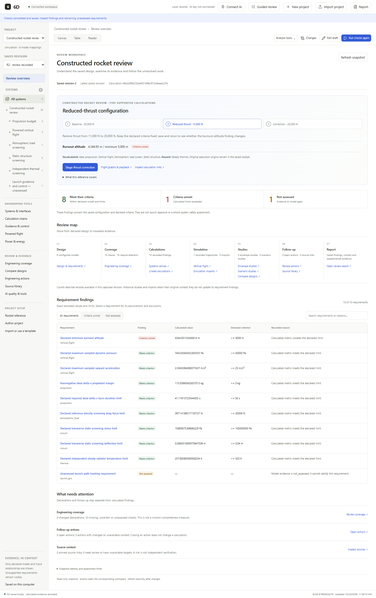

# 6D

**Change a space-system design. See which engineering evidence needs rechecking.**

6D connects requirements, bounded calculations, saved revisions and supporting references. It identifies affected checks after a change, reuses eligible unchanged results, and keeps unmet criteria separate from missing evidence. NVIDIA Nemotron, running through Nebius Token Factory, investigates the recorded evidence and explains what to check next.



*Actual application UI, calculated constructed rocket reference: reducing thrust makes the burnout-altitude criterion unmet while launch guidance remains unassessed. This is not NASA/ISRO/SpaceX flight data. The screenshot was captured in an isolated reference workspace.*

## Try it

**Focus refinement Build 2:** see calculation conclusions first, expand graphs and evidence on demand, and use **Engine thrust → Edit thrust** for your own sourced value. Staging, saving and calculating remain separate. [Guide](docs/FOCUS_BUILD2.md) · [Checks and preservation](docs/FOCUS_BUILD2_RESULTS.md). Conversational AI remains separate proposed work.

**Focus refinement Build 1:** stable rocket scrolling, genuine self-hosted Geist fonts and a **Hide sidebar / Show sidebar** control give the main work area more room. [Guide](docs/FOCUS_BUILD1.md) · [Checks and preservation](docs/FOCUS_BUILD1_RESULTS.md). Build 2 subsequently delivered result-first pages; conversational AI remains separate proposed work.

**Part 3 companion/context update:** the rocket parks clear of controls and has dock/reset/minimize options. The composer shows its saved evidence context, and reference preview → draft → save → link → question are explicit steps with unfinished drafts protected. [Guide](docs/PART3_ASSISTANT_WORKFLOW.md) · [Verification and preservation](docs/PART3_ASSISTANT_WORKFLOW_RESULTS.md).

**Part 2 readability update:** long authoring records and project context are grouped into expandable sections, repeated page introductions are reduced, compact quantities share SI typography with exact evidence still available, and similarly named projects show distinct ID-based labels without renaming or deleting records. [Guide](docs/PART2_READABILITY.md) · [Verification and preservation audit](docs/PART2_READABILITY_RESULTS.md). Part 3 subsequently delivered the companion refinements.

**Part 1 navigation/clarity update:** pages start at their headings, component names remain distinct in topic choices, Overview explains model-fit gaps separately from calculated criteria, and tool cards show evidence/configuration for the selected saved revision. [Guide](docs/PART1_NAVIGATION_CLARITY.md) · [Scoped checks](docs/PART1_NAVIGATION_CLARITY_RESULTS.md). The next two interface correction parts remain separate.

**Earlier companion/workflow update:** Calculate/Recalculate shows an explicit run's progress and completion, and Guided review opens in place. Drag the metallic 3D **Ask 6D** rocket to move it; click it for the simplified Nemotron or Tavily conversation. Source topics use grouped names with exact targets in Advanced, Source library has a progressive save/link flow, and shared typography covers the workspace. [Usage](docs/SIX_ISSUE_USABILITY.md) · [Scoped checks and limits](docs/SIX_ISSUE_USABILITY_RESULTS.md). No paid calls or physics changes were made by that refinement.

**Current delivery:** local desktop/browser application. A hosted judge URL is not available yet. Build F now provides an invitation-protected server, isolated visitor workspaces and a CPU-container/HTTPS deployment recipe; actual public deployment remains pending cost approval and platform checks. [Preparation results](docs/BUILD_F_RESULTS.md) · [Operator guide](docs/HOSTED_DEPLOYMENT.md) · [Submission checklist](docs/SUBMISSION_CHECKLIST.md). Opening localhost from another computer will not reach the developer's instance.

Python **3.10+** is required; the application runtime uses the standard library.

1. Clone this repository and enter its folder:
   ```console
   git clone https://github.com/aryamaan06/6D.git
   cd 6D
   ```
2. Prepare the local environment:
   ```console
   python tools/setup_local.py
   ```
3. Start the application, then open http://127.0.0.1:8768/:
   ```console
   python tools/open_preview.py
   ```

On Windows, `Setup-6D.cmd`, `Open-6D.cmd` and `Stop-6D.cmd` provide the same workflow; `py -3` may be used in place of `python`. On Linux/macOS, use `python3`. Windows has native launcher verification; the other platforms still need native qualification. [Setup, backup and recovery details](docs/RELEASE_HANDOVER.md).

The animated **Ask 6D rocket** stays available throughout the workspace and opens a centered conversation for **Nemotron investigations** or **Tavily reference search**. It offers **Nano, Super and Ultra per investigation**, with the chosen model recorded in history and the same shared spending controls. Selecting a model sends nothing; explicit **Ask Nemotron** starts the investigation. Inspector/Evidence sits in the central workspace with folded technical detail; there is no separate right-hand Assistant section. [Current companion guide](docs/SIX_ISSUE_USABILITY.md) · [Earlier entry-point delivery](docs/ROCKET_ASSISTANT_RESULTS.md) · [Measured model results and preserved failures](docs/THREE_MODEL_RESULTS.md).

Windows users can opt into **Remember on this device** separately for Nebius, Tavily and LangSmith. Protected keys restore locally after restart without provider calls. Tavily reservations and LangSmith preview/upload approval remain intact; credential files are excluded from backups. [Connection controls and limits](docs/REMEMBERED_SERVICE_CONNECTIONS.md) · [Build E checks](docs/BUILD_E_RESULTS.md).

The application opens on **Projects**. Select a saved project, then choose **Overview**, **Engineering**, **Simulations & studies**, **Evidence & review** or **Project setup**. Breadcrumbs and browser Back/Forward retain the saved-view location. [Navigation and typography guide](docs/WORKSPACE_NAVIGATION.md).

Overview connects the main design/change/recalculation journey and explains result states. **Owner settings** separates service management and development accounting from engineering work. Popups support outside-click/Escape dismissal, with confirmation before discarding edited authoring forms. Ultra's fresh six-case workflow screen passed all six constructed cases; the old 2/6 record remains dated history with three cases explicitly untested. [Build 3 guide](docs/BUILD3_CLARITY.md) · [Measured results and limits](docs/BUILD3_CLARITY_RESULTS.md).

For a connected rocket example, choose **Try the rocket example** on Projects or **Project setup → Rocket reference**, create the project and calculate its baseline. Review overview stages a thrust reduction and correction through the normal preview/save/rerun controls. Five bounded calculations share explicit inputs and scalar links; launch guidance stays unassessed. [Reference walkthrough and verification](docs/BUILD_A_RESULTS.md).

A fresh checkout opens without saved private project data or provider credentials. Use **Import project** to choose a constructed reference, explicitly create it, and **Run checks**. **Guided review** follows a design change; **Powered flight** offers its existing vertical-ascent reference. Loading a page never silently calculates a new verdict. [Powered-flight walkthrough](docs/POWERED_FLIGHT.md).

For horizontal motion, open **Powered flight → Planar ascent & steering** and use its constructed reference. A declared pitch programme drives saved downrange/altitude playback and engineering findings; controller tracking remains unassessed. [Build B walkthrough and checks](docs/BUILD_B_RESULTS.md).

For serial stages and variable thrust, select **Powered flight → Variable thrust & staging**. Its constructed reference includes editable stage/thrust forms, exact fuel/separation/ignition events, mass accounting and saved reports. [Build C walkthrough and checks](docs/BUILD_C_RESULTS.md).

The [October 25 final audit](docs/FINAL_BUILD_AUDIT.md) records the current feature-freeze decision, full-test caveat and October 14–20 history trace. A [sanitized retained AI-record index](docs/validation/RETAINED_AI_HISTORY_INDEX.json) preserves failure/success provenance without publishing private raw receipts.

## The engineering workflow

Judge-email recommendations and their concrete 6D actions, evidence and remaining gaps are tracked in [Judge guidance and remaining outcomes](docs/JUDGE_GUIDANCE_ACTIONS.md).

1. Supply project inputs, units, sources, model mappings and requirements using forms, CSV, values-only Excel or supported project JSON.
2. Calculate a saved baseline and inspect its findings, assumptions, numerical support and exclusions.
3. Edit a draft and preview the declared dependencies affected by a change.
4. Save the revision and explicitly rerun affected checks. Inspect calculation/reuse origins and compare retained runs.
5. Click the **Ask 6D rocket**, choose a requirement or whole-project scope, and explicitly investigate saved findings/changes with Nemotron. Its **Find references** tab searches with Tavily; review passages before manually saving/linking them in Source library. Track follow-up actions and export the evidence.

Working views include the system canvas/table/reader, review overview, change comparison, coverage, action queue, reports, orbital, vertical, planar and staged-flight playback, simulation-history imports and sampled operating-envelope studies. [Current capabilities and boundaries](docs/CONNECTED_REVIEW.md) · [Agreed A–F build scope](docs/HACKATHON_BUILD_SCOPE.md).

## How Nebius and Nemotron are used

The contextual Assistant calls **NVIDIA Nemotron through Nebius Token Factory** during actual investigations. Requirement scope offers bounded evidence reads and supported reproducibility rechecks. Whole-project scope connects saved findings, dependencies and changes, then recommends next checks; its exact numbers and change facts stay in application-owned tables. [Whole-project workflow and measured limits](docs/BUILD_D_RESULTS.md). The application owns numerical quantities, units, change directions and verdicts; model prose cannot replace them.

| Candidate | Recorded evidence | Current use |
| --- | --- | --- |
| Nano | Completed earlier case packs; rejected its first read action in the corrected October 20 three-case comparison, leaving two tasks untested. Build 2 records later corrected-protocol completions and source limits. | Available per investigation; not the default. |
| Super | Selected from earlier reviewed comparison evidence. An October 20 explanation reversed a limit-change direction; a separate offline replay under the new guard rejects it. Four earlier constructed qualification cases completed after that correction. Build D separately records a current-source project-specific changed-rocket check, historical generic replies and preserved rejections. | Selected project Assistant. |
| Ultra | Completed all three October 20 corrected-contract cases and all six Build 3 constructed workflow cases. Earlier failures/skipped cases remain intact; the separate current four-case quality pack is not established by these results. | Available per investigation; no automatic promotion or escalation. |

These observations concern particular protocols, cases and settings; they are not a universal model ranking. [Comparison results](docs/APPLICATION_ROLES_LIVE_RESULTS.md) · [Direction guard and replay](docs/CHANGE_DIRECTION_RESULTS.md) · [Recorded requirement qualification](docs/AI_QUALIFICATION_RESULTS.md).

Earlier live receipts retain their original policies and source identities. Build 3 adds a source-current Ultra six-case workflow result; this does not qualify every model/scope on the final source or replace human semantic validation. [Fresh and historical evidence](docs/BUILD3_CLARITY_RESULTS.md).

Connect a Nebius key privately through **Owner settings → Manage Nebius connection** after configuring an approved provider allowance. [Provider setup](docs/PROVIDER_SETUP.md). Local engineering calculations and saved evidence work without inference; new AI investigations require a usable Token Factory connection. No paid call occurs on startup or connection. The cumulative reservation ledger, per-job ceilings and no-retry policy remain enforced; reservations are not a provider invoice.

Tavily supplies explicit reference searches followed by human review/save/link steps. LangSmith receives only an explicitly approved, previewed metrics record. [Tavily live result](docs/TAVILY_LIVE_RESULTS.md) · [Connection and privacy details](docs/AI_QUALIFICATION.md). Each service has a separate private key form.

## Evidence, with scope attached

| Evidence | What it establishes |
| --- | --- |
| [1,000 generated edit cases, October 19](docs/RECALCULATION_VERIFICATION_RESULTS.md) | 742 valid edits matched full recalculation exactly; 258 invalid edits were consistently rejected. The same-calculator comparison checks reuse consistency, not independent physics correctness; this predates powered flight. |
| [30 published-reference/domain checks, October 19](docs/PUBLISHED_BENCHMARK_RESULTS.md) | Specified analytic, rounded and separate-tool checks across seven bounded models, with sources and tolerances. |
| [Current orbital reference comparisons](docs/NUMERICAL_ACCURACY_RESULTS.md) | Constructed cases compared with analytic/NASA CSPICE references after the RK4 improvement; numerical support remains separately gated. |
| [Powered-flight reference checks](docs/POWERED_FLIGHT_REFERENCE_RESULTS.json) | Recorded reference inputs, errors/tolerances and declared calculation scope. |
| [Earlier live requirement qualification](docs/AI_QUALIFICATION_RESULTS.md) | Super completed four constructed evidence tasks with 16 accepted responses. Separate coding-agent AI review found no material error in those four explanations; independent human review remains pending. |

[Build D results](docs/BUILD_D_RESULTS.md) retain all nine whole-project investigation attempts, including four completed histories and five stopped/rejected ones. The final current-source evidence is one specific changed-rocket case; USD0.6197628 was reserved across all attempts, below the USD0.80 ceiling. Generic historical replies and phrase-check false positives are disclosed alongside a caught incorrect direction claim.

The October 25 correction pass measured a 13-revision, 512-step orbital history: warm reads improved from 1.074 s to 0.056 s and new-store reads from 0.947 s to 0.280 s on shared development hardware, with identical complete returned evidence. The source-stable 1,000-edit check again had zero discrepancies, and 20 separate numerical-reference cases passed.

Full discovery ran 1,338 methods and exposed three outdated catalog/source-list test expectations; those were corrected and the affected 37 methods passed. Three development-only SciPy methods were skipped in the application environment and covered separately. No subsequent clean full-suite rerun is claimed. [Corrective results and caveats](docs/CORRECTIVE_BUILD_RESULTS.md).

[Validation index](docs/VALIDATION_INDEX.md) distinguishes historical full-suite counts, current targeted tests, browser assertions and reference checks. They are not additive. Full regression tests can be run with `python -m unittest discover -s tests`; they use synthetic provider transports, not paid inference.

## Submission-period development

[Complete project record](docs/PROJECT_RECORD.md) · [Documentation index](docs/DOCUMENTATION_INDEX.md) · [Published-file inventory](docs/PROJECT_RECORD_INVENTORY.json). These cover preserved work before A–C as well as the latest milestones, decisions, failures and remaining gaps.

The tracked repository begins on **October 14, 2026**. During October 14–24 the implementation added the engineering-evidence workspace, revision/reuse verification, authoring/intake, bounded orbital/flight calculations and accuracy gates, specialist history import, sampled studies, source/action/coverage workflows, and live Nemotron/Tavily/LangSmith integration. Dates and original outcomes remain in [historical development notes](docs/CHANGELOG.md).

The broader 6D concept predates some of this code. The repository history alone does not establish whether any earlier implementation existed before the submission period; the entrant must confirm that history in the submission. [Submission-period inventory](docs/SUBMISSION_PERIOD.md).

## Limits

The ten bounded models cover ideal propulsion, static beams, steady radiative equilibrium, single-condition drag, unforced two-body orbits, supplied power/energy budgets, single-axis spacecraft pointing, vertical ascent/coast, prescribed planar ascent and variable-thrust serial staged ascent. These are not complete engineering disciplines. Scalar links do not create simultaneous multiphysics coupling. Prescribed steering is not closed-loop guidance/control. Whole-project AI reviews the captured scalar evidence and declared gaps, with the exclusions in its guide. E remembered optional-service connections are implemented; F protected hosting is prepared/tested locally; public deployment remains pending.

There is no complete launch-to-orbit, reentry or landing simulator, hardware/flight qualification, customer validation or launch authorization. Current data/examples are constructed unless explicitly classified otherwise. Recorded playback is historical evidence, not a new live inference. The local loopback server must not simply be exposed publicly; Build F must provide appropriate access, isolation and spending controls.

## License and third-party notices

6D source is licensed under the [MIT License](LICENSE), approved by the project owner on October 24, 2026. Bundled third-party material retains its own notices; Lucide's license is preserved at [design/vendor/LUCIDE-LICENSE.txt](design/vendor/LUCIDE-LICENSE.txt). Referenced external tools/data are not relicensed by this repository.

Contributor instructions remain in [AGENTS.md](AGENTS.md); older planning records are archived under [docs/development](docs/development/README.md).
