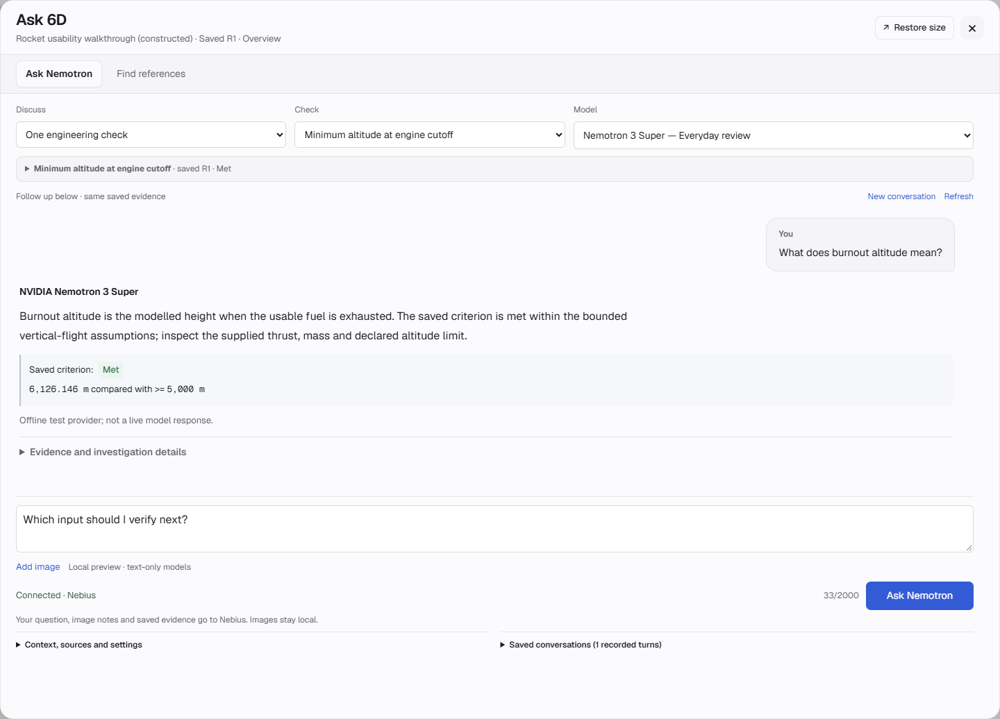

# 6D

**Change a space-system design. See which engineering conclusions need rechecking.**

An engineering calculation can be correct and still be out of date after a design change. 6D connects requirements, explicit inputs, bounded calculations and saved evidence. It traces affected checks, reruns those checks, reuses eligible unchanged results and retains the reason behind each conclusion.

NVIDIA Nemotron through **Nebius Token Factory** investigates the saved evidence and explains next steps. The application keeps calculated values and requirement outcomes authoritative.

**[Current capabilities and known gaps](docs/CURRENT_STATE.md) · [Evidence index](docs/VALIDATION_INDEX.md) · [Repository guide](docs/REPOSITORY_GUIDE.md)**



*Actual interface capture from an isolated constructed browser fixture. The displayed assistant answer is synthetic/offline, not a fresh Nemotron response or real mission data.*

## Try the live demo

**Live hosted application:** [https://sixthdimension.centralindia.cloudapp.azure.com](https://sixthdimension.centralindia.cloudapp.azure.com)  
**Judge access code:** `6d-space-judge-review-access-2026`  

Each visitor receives an isolated persistent session with the pre-populated rocket demonstration. Native HTTPS is automatically provisioned.

1. Open the URL and enter the access code.
2. Explore **Projects → Try the rocket example** with its constructed reference project.
3. Calculate or inspect the baseline. Read its met, unmet and unassessed findings separately.
4. Change a sourced input, preview its dependencies, save the revision and recalculate.
5. Compare what changed, what ran again and what reused earlier evidence. Open the report for exact values, assumptions and exclusions.
6. Click the **Ask 6D rocket** to question Nemotron about that saved evidence or find supporting references through Tavily.

The prepared thrust-change example makes one burnout-altitude criterion become unmet while launch guidance stays unassessed. It demonstrates the evidence workflow using constructed inputs; it is not a reconstruction of a real mission.

## Run locally

Requires **Python 3.10+** and Git. The application runtime uses the Python standard library; setup downloads no packages.

```console
git clone https://github.com/aryamaan06/6D.git
cd 6D
python tools/setup_local.py
python tools/open_preview.py
```

Open **http://127.0.0.1:8768/** on that computer. Windows also has `Setup-6D.cmd`, `Open-6D.cmd` and `Stop-6D.cmd`. On Linux/macOS use `python3`; native desktop-launcher qualification remains Windows-specific. The protected Linux/container checks are a separate deployment path. [Opening, update and recovery instructions](docs/OPEN_6D.md).

Engineering calculations work without a model connection. Live questions require a Nebius key entered privately in the application and an approved allowance. Connection/startup makes no inference request. Do not put keys in project inputs, screenshots or Git. [Provider setup](docs/PROVIDER_SETUP.md).

## What is implemented

- **Connected engineering review:** system canvas/table/reader, explicit SI inputs, requirements, dependency tracing, saved revisions, targeted recalculation and retained evidence receipts.
- **Bounded analysis and playback:** ten supported models, orbital and ascent histories, serial staging, imported simulation histories and sampled operating-envelope studies. These are scoped models, not complete engineering disciplines.
- **Evidence and follow-up:** supporting sources, change comparisons, declared coverage gaps, action tracking and review exports. Forms, CSV, values-only Excel and supported project JSON provide intake paths.
- **Contextual AI:** requirement or whole-project investigations with an explicit “Choose a model” starting state, Nano/Super/Ultra guidance, expandable conversation and saved answers. Exact numerical facts stay application-owned. Local image previews submit user-written notes, not pixels. [Current interface and verification](docs/CHAT_READABILITY_RESULTS.md).

## How the tools contribute

| Tool | Job inside 6D |
| --- | --- |
| **Nebius Token Factory + NVIDIA Nemotron** | Live, bounded evidence-reading/recheck actions and explanations tied to a saved project/revision. The selected model and actual outcome are retained. |
| **Tavily** | Explicit reference search. Results remain previews until a person reviews, saves and links a passage. Search does not validate a calculation. |
| **LangSmith** | Optional, previewed and separately approved qualification metrics export. It does not calculate engineering results. |

Model choices have separate per-job bounds and share persistent cumulative reservation accounting. No automatic escalation or transport retries are used. A larger model is not treated as evidence of greater correctness.

**Current scoped conversation check:** Nano, Super and Ultra each completed two live turns on the same constructed burnout-altitude evidence. Useful answers and concrete next checks were observed; Nano remains repetitive and Ultra verbose. Earlier failures and an unsupported Super assurance were retained and drove guard corrections. These six turns do not establish general answer accuracy. [Results and limits](docs/CHAT_READABILITY_RESULTS.md) · [Latest sanitized live record](docs/validation/CHAT_READABILITY_LIVE_BATCH4.json).

## Evidence to inspect

| Recorded check | What it supports |
| --- | --- |
| [1,000 generated edit cases](docs/RECALCULATION_VERIFICATION_RESULTS.md) | Targeted/full recalculation consistency on the stated October 19 cases: 742 valid edits matched; 258 invalid edits were rejected. This is not independent physics validation. |
| [Published-reference checks](docs/PUBLISHED_BENCHMARK_RESULTS.md) | Sourced analytic, rounded and external-tool comparisons for seven bounded models at that checkpoint. |
| [Orbital accuracy](docs/NUMERICAL_ACCURACY_RESULTS.md) and [powered-flight references](docs/POWERED_FLIGHT_REFERENCE_RESULTS.json) | Declared constructed cases, comparison methods, errors and tolerances. |
| [Validation index](docs/VALIDATION_INDEX.md) | Current scoped checks, historical full-suite caveats, browser evidence and preserved live successes/failures. Counts are not additive. |

## Boundaries

6D does not provide complete rocket physics, simultaneous multiphysics coupling, closed-loop launch guidance, complete launch-to-orbit/reentry/landing simulation or launch authorization. Passing a supplied criterion does not validate the criterion, the design's applicability or mission success. Unsupported or insufficiently supported requirements stay unassessed.

Examples are constructed unless explicitly identified otherwise. Saved playback is recorded calculation evidence. Receipts use local integrity digests, not signed certification. Independent human engineering review, customer validation and public deployment remain separate gaps.

## Project record and license

Use [CURRENT_STATE.md](docs/CURRENT_STATE.md) for today's capabilities and limitations. Older build reports preserve what was observed at their own dates; their screenshots, model results and build IDs are not promises about the latest version. [Complete chronology](docs/PROJECT_RECORD.md) · [Submission-period disclosure](docs/SUBMISSION_PERIOD.md) · [Historical records](docs/development/README.md).

6D is licensed under [MIT](LICENSE). Bundled third-party notices remain with their assets, including [Geist fonts](docs/GEIST_FONTS.md) and [Lucide](design/vendor/LUCIDE-LICENSE.txt). Contributor instructions are in [AGENTS.md](AGENTS.md).
