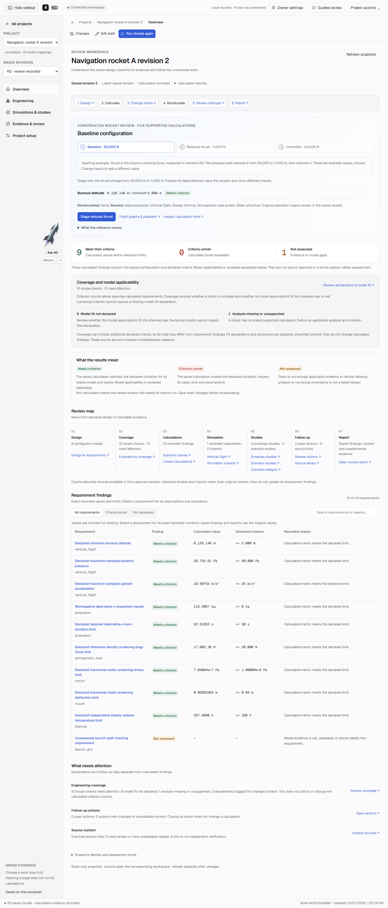

# Focus refinement Build 1 — results

Completed October 27, 2026. Actual owner opening address: **http://127.0.0.1:8768/**. Verified build **acd4b22a579d**; `restart_required: false`. [Usage](FOCUS_BUILD1.md) · [Acceptance](FOCUS_BUILD1_ACCEPTANCE.md) · [Sanitized checks](validation/FOCUS_BUILD1_CHECKS.json)

## Delivered scope

Sustained scrolling no longer triggers companion collision chasing, full/compact oscillation or a delayed parking snap. Incidental scroll-time layout observers are suppressed for positioning while native modal visibility remains immediate. Deliberate placement/layout requests still park against current visible controls. Renderer pause updates and preference writes are deduplicated; full launcher/options/canvas bounds are tested. The fixed rocket may overlay scrolling text; users retain explicit dock/drag/minimize. This is an intentional tradeoff, not a claim of avoiding every moving page element.

The owner shell, legacy controls, technical data, canvas axis labels and hosted invitation page now use actual locally served Geist faces. Four unchanged normal/italic variable WOFF2 files, their OFL and pinned release/provenance are retained. Exact font routes use `font/woff2`, same-origin font CSP and no runtime CDN. Fonts/license/provenance are declared in Python package data and included by existing source/container copying. Source values, numeric results and exports are unchanged.

A header sidebar toggle and Ctrl/Cmd + backslash shortcut preserve the mounted page, open form entries, route and saved project context. Desktop/mobile preferences are separate. Hidden navigation is removed from keyboard traversal, a collapsing focused sidebar returns focus to the header control, and the central grid uses the recovered width. No right panel or new destination is introduced.



*Actual UI captured during isolated browser verification, using constructed projects. This image is not owner/private data or a live-model result.*

## Measured checks

| Check | Result and scope |
| --- | --- |
| Python API/static/hosted boundaries | Initial **45 methods: 44 passed, one Docker-unavailable skip**. After adding the font package-data regression, the packaging subset passed three of four methods with the same skip. Union: **46 distinct methods, 45 passed, one skip**; overlapping runs are not added. |
| Real Chromium fixtures | **11 passed:** eight rocket cases and three actual font cases. Includes 24 nested-scroll steps with sticky mutations/post-scroll waiting, unchanged viewport coordinates/mode/canvas and zero new position writes. Includes actual four-face decoding, independent Sans-versus-Arial metrics, Mono equal widths, OFL/hash provenance and legacy heading overrides. |
| Integrated browsers | **42 groups passed:** 27 navigation/sidebar/readability and 15 companion/reference groups. Zero external requests, unexpected HTTP errors or browser errors. Tests cover full-width main area, persisted desktop choice/reload, independent mobile controls, Back/Forward, unapplied author-form entries retained through sidebar toggling, exact exports, all three Nemotron choices, explicit save/link/Ask and hosted owner boundaries. |
| Existing Node contracts | **15 passed:** history and exact saved assistant context. |
| Actual owner | All 13 projects remain visible. The existing walkthrough opens, uses Geist Sans with heading weight 700, and hides/restores its sidebar. No owner calculation, draft save, inference, search or upload was initiated. |
| Preservation | All **28 checks matched exactly**: 23 active database tables, three encrypted credential files and two service/model configuration files. Existing records, failures, defaults and allowances were retained. All three services restored present/remembered without credential errors. |
| Runtime/source policy | 64 Python files pass canonical LF checks; JavaScript syntax and whitespace pass. Exact committed Python bytes and remote synchronization are checked on publication. |

An integration review caught the omitted nested font package-data patterns; these were corrected and checked. A final owner inspection found an older module overriding heading weight, so shared heading weights were made explicit and a legacy-override rendering case verifies them. The browser DOM inspection interface could not enumerate FontFace records; actual decoding/metrics were instead verified by the dedicated Chromium fixture and computed family/weight were inspected in the owner UI.

The installed-wheel manifest was checked, but no new wheel was built because packaging tooling was unavailable in the selected local runtime. No new actual Linux container or internet deployment is claimed. These are affected UI/API checks, not full-suite, independent engineering or new live-AI qualification. No paid service call was made by this build.

## Reproduce

Use `PYTHONPATH=src;tests` on Windows (`src:tests` on POSIX):

```console
python -m unittest test_workspace_navigation_assets test_workspace_api test_owner_settings_boundary test_hosted_server test_hosted_packaging -q
node --test tests/rocket_placement.test.mjs tests/geist_typography.test.mjs
node --test tests/workspace_navigation.test.cjs tests/assistant_context.test.cjs
node tools/check_navigation_browser.mjs
node tools/check_usability_browser.mjs
python tools/check_source_consistency.py --git-ref HEAD
```

Playwright/Chrome and temporary loopback access are required for browser fixtures. `PLAYWRIGHT_MODULE` and `SIXD_TEST_PYTHON` can select installed runtimes. Private snapshots and detailed logs stay in ignored local folders. Build 2 (result-first disclosure/thrust editing), Build 3 (conversation/model/spelling/image path) and public hosting were not started by this build.
