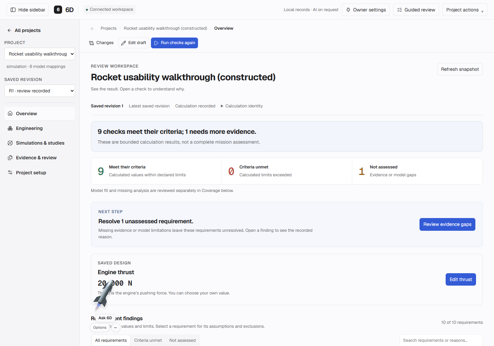

# Focus refinement Build 2 — results

Delivered October 27, 2026: result-first Overview/report, optional graph/evidence sections, and sourced arbitrary thrust editing. Local build **696ed8991d1b**. [Usage](FOCUS_BUILD2.md) · [Acceptance](FOCUS_BUILD2_ACCEPTANCE.md) · [Sanitized checks](validation/FOCUS_BUILD2_CHECKS.json).



*Actual application captured during synthetic local acceptance. This is constructed data, not an owner/private project or a live-model result.*

## Implemented behavior

Overview shows canonical criteria counts, a short bounded conclusion and one next action before optional explanatory content. Selecting a result inserts its explanation directly after the chosen row. Coverage/model-fit gaps stay visible and separate from numerical findings. Reports show individually expandable requirement results, keeping exact evidence, assumptions, methods, references, graphs and receipt identity accessible.

Actual current thrust is visible and editable even when a custom value leaves the strict prepared reference profile. Positive finite values and a source stage only a shared draft after impact preview. Save and recalculation remain explicit separate operations; prior revisions and numerical evidence are preserved. Non-newton bindings are not silently converted, and historical values are not editable.

Vertical, guided and staged playback retain saved-check summaries and primary playback. Additional graphs, sample tables, numerical diagnostics and provenance are optional. Orbital history redraws on expansion; its accuracy status remains visible. Sweep/envelope plot and matrix details, reference passages and search metadata are folded. Coverage's form opens explicitly on check selection/Add. Printed details are expanded and their original screen state restored afterward.

## Measured checks

| Check | Result and scope |
| --- | --- |
| Affected Python contracts | **78 methods: 77 passed, one Docker-unavailable skip.** Saved revisions, connected review, rocket reference, source APIs, owner settings, navigation/static assets, saved accuracy rendering and hosted boundaries. |
| Node contracts | **28 passed:** Overview coverage/exact values, reference save/link/Ask separation, browser history and captured assistant context. |
| Browser acceptance | **52 groups passed:** ten Build 2, 27 navigation/readability/sidebar and 15 companion/reference groups. Isolated synthetic servers; zero external traffic, unexpected HTTP failures or browser errors. |
| Thrust workflow | Invalid blank/zero/negative inputs rejected; 17,500 N with source stages a draft only; explicit save creates R2, explicit calculation records its results. Custom thrust remains discoverable and editable; original R1 evidence and exact project export match. Cancelled form dismissal retains unapplied entries. |
| Disclosure/printing | Inline exact findings, same-context refresh, nested flight graphs, sample choices through cutoff events, actual nonempty orbital canvas after opening, different-context isolation, sweep/envelope graph selection retention and full print expansion/restoration passed. Coverage reopens an intentionally collapsed editor after check/Add selection. |
| Actual owner inspection | The existing saved R3 walkthrough opens with its recorded nine met/one unassessed criteria, current 20,000 N and prior 11,000 N. Edit thrust opens with the saved source; it was closed without staging, saving, calculating or sending any AI/search/upload. |
| Preservation/restoration | All **28 checks matched exactly**: 23 active database tables, three encrypted credentials and two configuration files. All three services restored present/remembered without credential errors. Existing history, failures, defaults and allowances remain. |
| Runtime/source policy | All **36** source JavaScript files parse. All **64** Python runtime files pass canonical LF consistency; committed-byte consistency and remote synchronization are verified on publication. First-party whitespace check passes. |

During integration, prior browser tests were updated to explicitly open the now-optional workflow/reference sections and locate the still-visible report warning in its new conclusion container. The pure playback-renderer fixture now loads the real shared unit formatter and supplies the captured disclosure context; its initial fixture failure is not described as a passing run. The companion regression waits for resize positioning to settle. A coverage-editor reopening issue and duplicate orbital toggle-listener binding were corrected before delivery.

No paid requests, solver changes, new live-AI qualification or public deployment occurred. These are affected interface/API regressions, not a fresh full-suite run, independent physics validation or proof of human usability. Visual acceptance remains with the founder. Conversational AI/image input, spelling and model-guidance refinements remain proposed Build 3.

## Reproduce

Use `PYTHONPATH=src;tests` on Windows (`src:tests` on POSIX):

```console
python -m unittest test_workspace_api test_connected_review test_rocket_reference_workflow test_rocket_reference_profile test_workspace_sources_api test_source_research_api test_owner_settings_boundary -q
python -m unittest test_workspace_navigation_assets test_accuracy_playback test_hosted_server test_hosted_packaging -q
node --test tests/review_workspace_coverage.test.cjs tests/source_workflow.test.mjs tests/workspace_navigation.test.cjs tests/assistant_context.test.cjs
node tools/check_focus_build2_browser.mjs
node tools/check_navigation_browser.mjs
node tools/check_usability_browser.mjs
python tools/check_source_consistency.py --git-ref HEAD
```

Browser scripts require Playwright/Chrome and temporary loopback access. `PLAYWRIGHT_MODULE` and `SIXD_TEST_PYTHON` select installed runtimes. Raw logs, synthetic databases and owner-preservation snapshots stay local in ignored folders.
