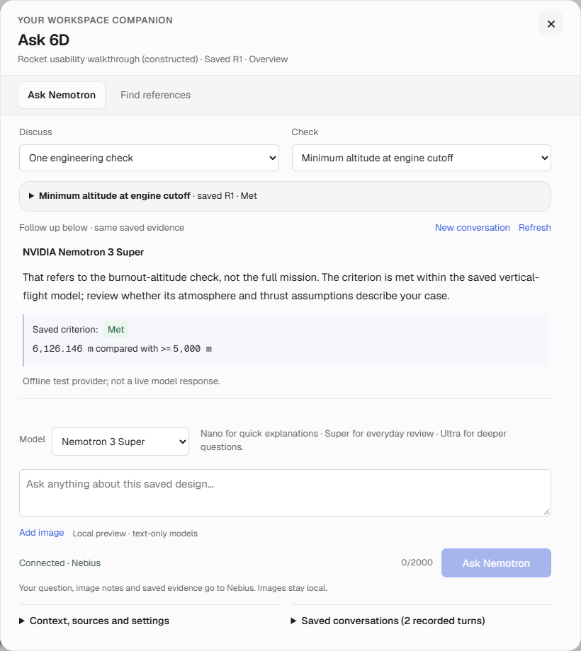

# Focus refinement Build 3 — results

Delivered October 27, 2026: conversation-first Nemotron presentation, bounded saved-context follow-ups, remembered explicit model choice, local image notes and user-controlled native spelling. Local build **09318028ba85**. [Guide](FOCUS_BUILD3.md) · [Acceptance](FOCUS_BUILD3_ACCEPTANCE.md) · [Sanitized checks](validation/FOCUS_BUILD3_CHECKS.json).



*Actual browser capture from an isolated constructed fixture. The screenshot explicitly shows an offline test provider. It is not a real Nemotron response or owner/private data.*

## Delivered behavior

Accepted answers precede expandable evidence, rather than following long deterministic guidance/tables. The composer stays compact and finished answers come into view. Failed/rejected interpretations cannot appear as accepted answers. Exact recorded criteria remain visible and complete original investigation records remain inspectable/downloadable.

Question-first prompts replace generic example seeding. An optional parent ID is resolved from intact completed server records; clients cannot supply assistant history. Prior prose is bounded to three whole pairs and 6,000 characters, with an omission count. Scope, project/revision/run/review, selected test and frozen references must match. The existing required reads/recheck, numerical/status/direction guards, provider boundary, per-job limits and cumulative approval remain unchanged. Queued records retain enough saved identity to display the active question after reload without treating it as an accepted parent.

The browser remembers Nano/Super/Ultra choice only as a UI preference. Image signatures, container dimensions, actual decoding and byte limits are checked locally; only explicit user notes enter the question payload. Image checking blocks Send, preventing a race that could otherwise discard a pending selection. Native spelling attributes enable user-selected corrections without rewriting or checking credentials.

## Verification

| Check | Observed result and scope |
| --- | --- |
| Python contracts | **128 methods passed**, no skips: workspace jobs, requirement/project investigation, actual action-provider protocol, bounded conversation history, HTTP request validation, model accounting, asset serving and hosted boundaries. |
| Node/component contracts | **39 passed**, including real Chrome local image decoding plus conversation escaping/states, exact test/reference parent eligibility, active queued identity, preference persistence and existing reference/context/history contracts. |
| Integrated browsers | **57 groups passed:** five Build 3, 27 navigation, 15 companion/reference and ten exact-context handoff groups. Synthetic providers only; zero external traffic, unexpected HTTP responses or browser errors. |
| Follow-up | Two explicit synthetic turns preserve the initial question, accepted answer and server-validated parent. New/resumed conversations send nothing. Invalid, failed/pending, cross-project/revision/run/scope/test/reference, corrupt and oversized history is rejected before a new reservation. |
| Image privacy/intent | PNG/JPEG/WebP preview, invalid formats/signatures/size/dimensions/animations/decoding, context isolation, four-context memory bound, removal/clear and held-decode/cancellation behavior passed. Submitted payload contains only notes, with no filename, image bytes, base64, image URL or vision claim. |
| Evidence/workflows | Canonical criteria remain visible before expandable evidence. Exact source save/link/Ask, selected test row, history, drafts, fonts, mobile containment, hosted owner boundaries and original design/metric values pass the regression fixtures. |
| Actual owner | The existing historical R3 walkthrough and its preserved Nano answer were inspected read-only through the rocket. No owner question, calculation, draft save, image transfer, search or metrics upload was initiated. |
| Preservation | All **28 original-state checks match exactly**: 23 database tables, three encrypted credential files and two configuration files. All three remembered services restore present/remembered without credential errors. |
| Source/runtime | All **38** browser JavaScript files parse; all **64** Python runtime files pass LF consistency. Committed-byte consistency and remote synchronization are checked on publication. |

Review caught and corrected automatic selection of a different test/reference parent, loss of active queued context on reload, a Send-versus-image-check race, and a chat layout that gave too little room to the answer. Earlier test failures included a stale strict-tool-schema fixture, local socket permissions and selectors that assumed context metadata was always expanded. Failed runs are not counted as passing. The final affected tests pass; this is not a fresh full-suite or independent semantic/physics validation.

## Live test status

**No paid inference, Tavily search or LangSmith upload ran for this milestone.** Automatic approval review blocked a proposed two-turn Super check because earlier approvals did not clearly cover transmitting this specific saved evidence/follow-up payload to Nebius with a $0.40 ceiling. An explicit approval question was presented; the test remains unrun while that approval is pending. No indirect workaround or retry was executed, and no cost was reserved.

Existing live receipts remain historical after these prompt/conversation source changes. Synthetic completion establishes the protocol and UI path, not current model answer quality. Independent human review, a newly approved live conversation and public hosting are not claimed by this result.

## Reproduce

Set `PYTHONPATH=src;tests` on Windows (`src:tests` on POSIX):

```console
python -m unittest test_workspace_ai test_project_investigation test_project_provider test_whole_project_investigation test_conversation_context test_workspace_ai_api test_workspace_navigation_assets test_hosted_server test_workspace_model_choices -q
node --test tests/assistant_conversation.test.mjs tests/assistant_attachments.test.mjs tests/source_workflow.test.mjs tests/assistant_context.test.cjs tests/workspace_navigation.test.cjs
node tools/check_focus_build3_browser.mjs
node tools/check_navigation_browser.mjs
node tools/check_usability_browser.mjs
node tools/check_assistant_context_browser.mjs
python tools/check_source_consistency.py --git-ref HEAD
```

Browser fixtures require Chrome/Playwright and temporary loopback access; `PLAYWRIGHT_MODULE` and `SIXD_TEST_PYTHON` select installed runtimes. Detailed fixtures/logs and private preservation snapshots remain in ignored folders. No new physics, production deployment, automatic routing, spending approval or image-vision capability was added.
