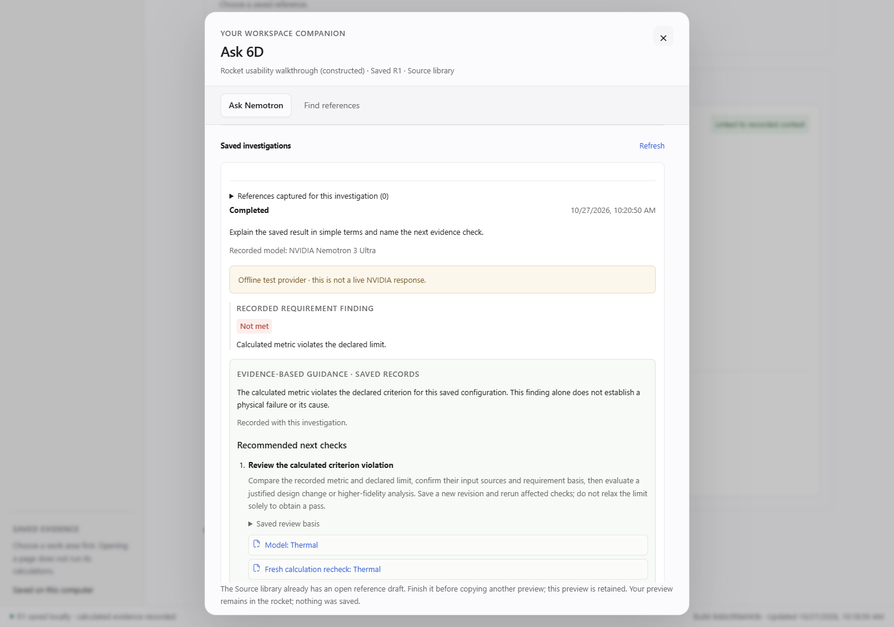

# Part 3 — delivery evidence

Completed October 27, 2026; authorized October 26. The actual owner application is verified at **http://127.0.0.1:8768/**, build **8ddc0fde043b**, with `restart_required: false`. [Guide](PART3_ASSISTANT_WORKFLOW.md) · [Acceptance](PART3_ASSISTANT_WORKFLOW_ACCEPTANCE.md) · [Sanitized checks](validation/PART3_ASSISTANT_WORKFLOW_CHECKS.json)

## Delivered

The local 3D rocket retains free dragging and remembers its preferred position. On release and layout changes it parks clear of visible interactive controls where space permits. Options provide help, safe docking, reset and explicit minimize/full controls. Crowded layouts use compact access or a normal-flow fallback below the header. Existing dialogs hide the companion; reduced-motion and graphics fallback remain functional. This is bounded DOM collision avoidance, not a guarantee against every third-party overlay or browser extension.

The Nemotron composer visibly identifies saved project/revision/calculation, page, scope/check, canonical finding, compatible selected test row and scoped reference availability. Page/selected-item changes get an appropriate ordinary-launch default. Explicit same-context scope/check changes preserve the question visibly. Other project/revision/run contexts do not inherit a question or test row automatically; incompatible rows are parked and excluded. Empty requirement scope is blocked before a request. Reference summaries and callbacks reject stale project/revision/run/draft profiles.

Tavily preview, unsaved copied source, saved source version and linked record are distinct stages. Copy refuses to overwrite an unfinished source or link draft, keeps its preview and reports the actionable reason inside the rocket. Save and link remain separate manual operations. A current linked source offers an explicit scoped question handoff without starting Nemotron. The loaded library publishes only its validated current profile to the shell; a delayed or invalid profile cannot become current context.

No solver, provider protocol, default Super selection, approval/cap, hosted policy or stored numerical evidence was changed. No real inference, search or telemetry upload was initiated by this build.



*Actual UI in a synthetic temporary test workspace. The example NASA URL/excerpt and provider answers are fixtures, not independently verified sources or live qualification.*

## Verification

| Check | Measured result and scope |
| --- | --- |
| Affected Python | **81 methods: 80 passed, one Windows Docker-unavailable skip.** Final source/asset/owner/hosted subset rerun: 59 methods, 58 passed and the same skip. Counts overlap; do not add them. |
| Node contracts | **51 passed**, including exact/stale assistant context, source/link draft preservation, validated load callbacks, retained failed previews, existing display/units/coverage/navigation/tool status. |
| Real Chromium placement | **Seven cases passed:** legacy position migration, free drag, viewport/scroll/new-control collision avoidance, dock/reset/minimize/keyboard, automatic compact/full, no-slot normal flow, dialog hiding/drafts and reduced motion. |
| Integrated browsers | **51 groups passed:** 26 navigation/readability, 15 companion/reference and ten context groups. Zero external requests, unexpected HTTP responses or browser errors. Synthetic explicit calculation, Ask, search, save/link and invitation login are recorded separately in the checks. |
| Actual owner | 13 existing projects visible; actual walkthrough opens whole-project scope from Overview with all three choices and default Super. No owner draft, calculation, Ask, search, save or link was submitted. Nebius, Tavily and LangSmith all restored present/remembered without restore errors. |
| Original state | All **23 active database tables**, three encrypted credential files and two service/model configuration files match the private baseline. 77 of 78 sampled local files match; only the ordinary startup log changed after restart. Historical backups, owner investigations, reservations and failures were retained. |
| Source/publication | 64 Python files pass canonical LF consistency. JavaScript syntax and whitespace checks pass. Exact committed source and remote synchronization are checked on publication. |

The selected-test-row investigation callback is tested through its existing hidden DOM control. This proves exact argument/context handling, not a newly exposed visible test-row journey. Scoped source counts mean available links, not a promise every excerpt is sent: existing capture limits and review/applicability warnings remain.

The final browser runs corrected harness assumptions about uppercase visual labels, preferred versus safely adjusted rocket coordinates, mobile compact geometry and subsystem navigation. Those earlier harness failures are not counted as successful runs. The review also found and fixed a null-check context edge, a missing initial library-cache callback, an unfinished-link overwrite and a refusal message hidden behind the dialog. Final regressions cover those cases.

## Reproduce

Use `PYTHONPATH=src;tests` on Windows (`src:tests` on POSIX):

```console
python -m unittest test_workspace_navigation_assets test_workspace_api test_connected_review test_workspace_sources test_workspace_sources_api test_workspace_research test_source_research_api test_owner_settings_boundary test_hosted_packaging -q
node --test tests/assistant_context.test.cjs tests/source_workflow.test.mjs tests/source_targets.test.mjs tests/display_units.test.cjs tests/workspace_project_choices.test.cjs tests/review_workspace_coverage.test.cjs tests/workspace_navigation.test.cjs tests/workspace_tool_status.test.cjs
node --test tests/rocket_placement.test.mjs
node tools/check_navigation_browser.mjs
node tools/check_usability_browser.mjs
node tools/check_assistant_context_browser.mjs
python tools/check_source_consistency.py --git-ref HEAD
```

Browser tools require Playwright/Chrome and temporary loopback access. `PLAYWRIGHT_MODULE` / `SIXD_TEST_PYTHON` select installed runtimes. Private owner snapshots, logs, keys and raw receipts remain ignored locally. These checks are not full-suite, new live-model, independent semantic or physical validation. Public deployment was not performed by Part 3.
